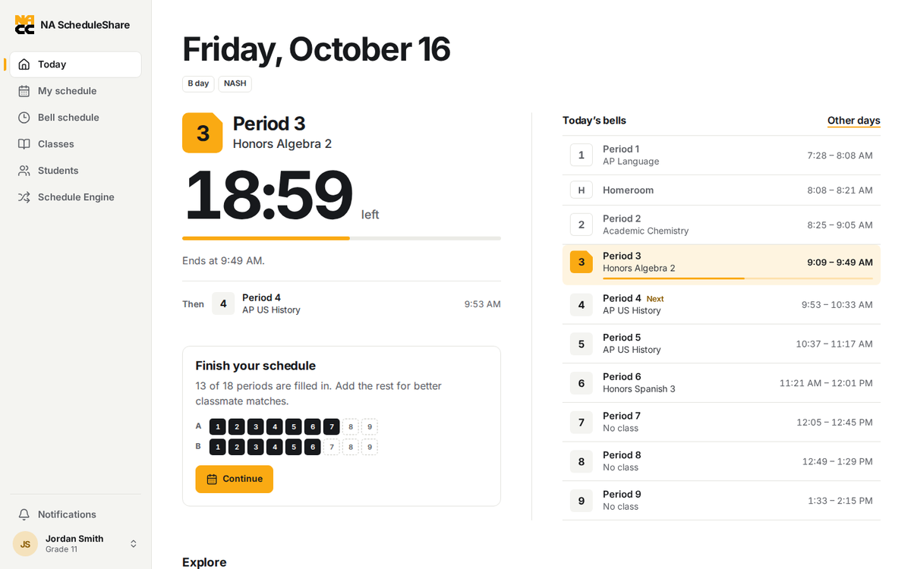
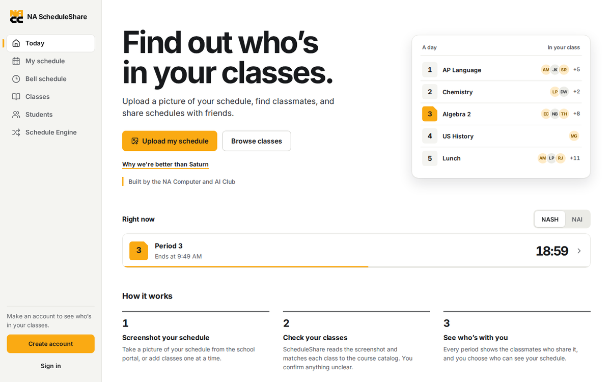
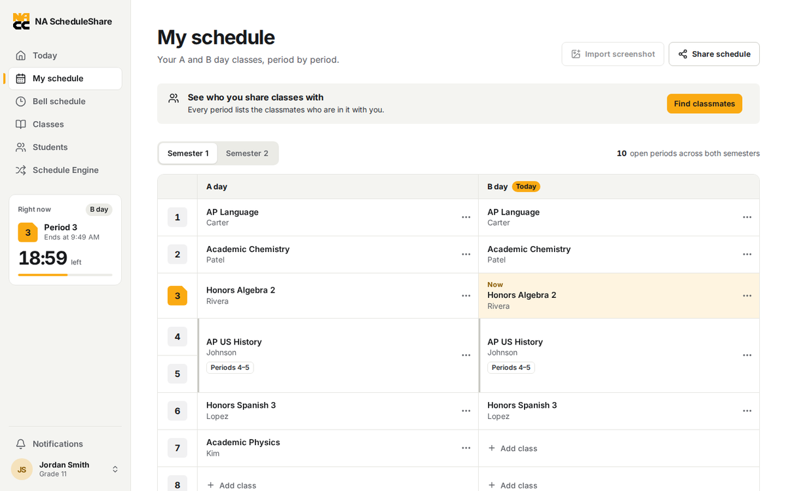
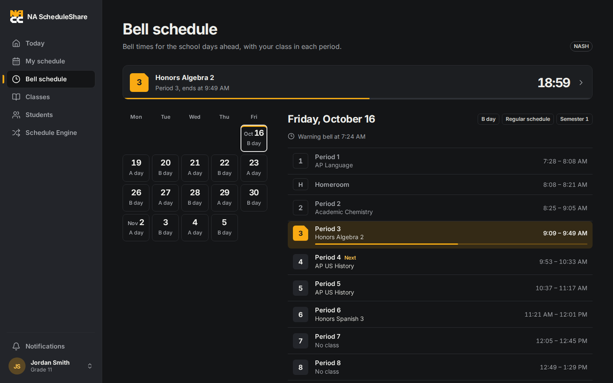
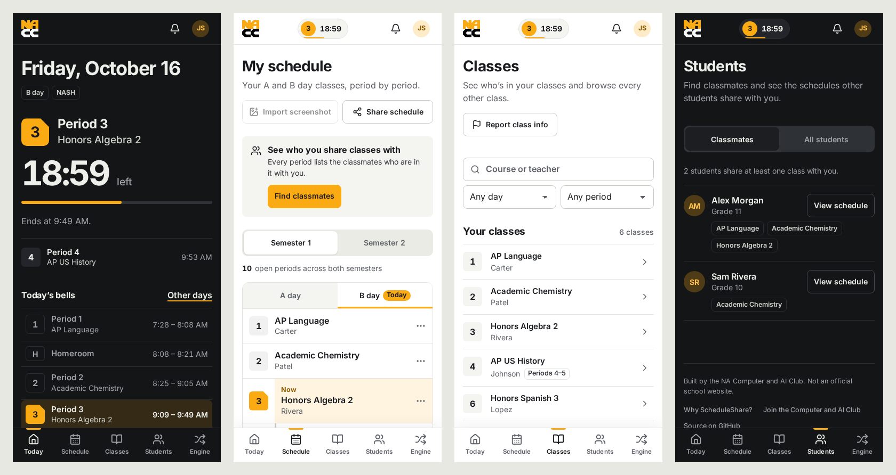
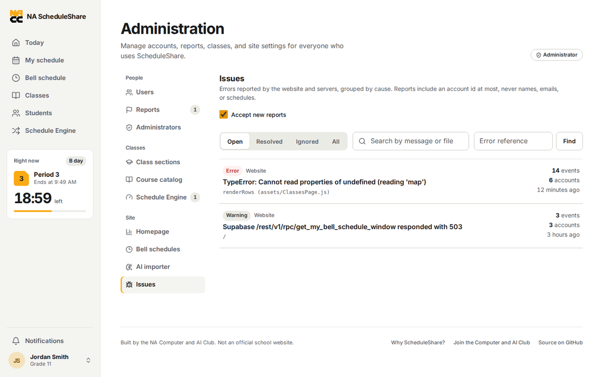

# ScheduleShare design system

This is the reference for every screen in the app. Read it before changing UI.

## Idea

The school day is the product's structure. North Allegheny students live by a
bell: nine periods, an A/B rotation, two semesters. ScheduleShare uses that
rhythm as its visual language instead of decorating around it.

- **Period numerals are the recurring motif.** Periods are a real sequence, so
  numbering them is information, not ornament. Large tabular numerals mark
  periods in the bell timeline, the schedule grid, and class rows.
- **Gold means "now" or "yours".** NA gold marks the current period, the active
  navigation item, the primary action on a screen, and the student's own
  classes. It is never a background wash and never decoration.
- **Quiet everywhere else.** White paper, graphite text, hairline rules. Content
  is grouped by headings, space, and divided lists — not by stacks of cards.

## Tokens

All colors, radii, shadows, and type sizes come from `src/styles/tokens.css`.
Feature CSS must use tokens (`var(--…)`) and never raw hex values, so light and
dark themes both work.

| Token | Light | Use |
| --- | --- | --- |
| `--paper` | `#ffffff` | Page and panel surfaces |
| `--chalk` | `#f4f4f1` | Sunken surfaces: sidebar, table heads, inputs at rest |
| `--ink` | `#17191c` | Primary text, strong rules, dark UI |
| `--slate` | `#5d6066` | Secondary text (≥ 4.5:1 on paper) |
| `--line` | `#e4e4e0` | Hairline dividers |
| `--line-strong` | `#cacac4` | Control borders |
| `--gold` | `#ffae00` | Now / primary action fill (always with `--on-gold` text) |
| `--gold-ink` | `#8a5b00` | Gold-family text on paper |
| `--gold-wash` | gold 12% | Selected rows, current period row |
| `--danger`, `--success`, `--info` | | Status only |

Gold text on white fails contrast. Use `--gold-ink` for gold-family text and
`--gold` only as a fill or as a thick rule next to text that carries meaning.

### Type

Inter (self-hosted, latin) with `cv11` (single-storey a) and open digits
(`cv02`, `cv03`, `cv04`). Times and countdowns use `font-variant-numeric:
tabular-nums` via `.numeric`.

| Role | Size / weight |
| --- | --- |
| Display numerals (countdown) | `--text-display` 64–104px / 700, tracking −0.045em |
| Page title (`h1`) | `--text-2xl` 30–36px / 700, tracking −0.025em |
| Section title (`h2`) | `--text-lg` 19–21px / 650 |
| Body | `--text-md` 16px / 400, line-height 1.5 |
| UI / secondary | `--text-sm` 14px |
| Caption | `--text-xs` 12.5px (sparingly) |

Rules:
- Sentence case everywhere. No all-caps labels, no tracked-out eyebrows.
- Do not join metadata with middle dots. Put separate facts in separate
  elements (chips, a definition row, or a short sentence).
- Buttons say exactly what happens ("Import screenshot", "Copy link"). No
  arrow glyphs appended to button text.
- Lines of prose stay under ~70 characters (`max-width: 62ch`).

### Shape and depth

- `--radius-control` 8px: buttons, inputs, chips.
- `--radius-panel` 12px: grids, panels, dialogs.
- `--radius-pill` 999px: avatars, status pills, the now pill.
- Shadows only on things that float: dialogs, popovers, the mobile tab bar.

### Motion

- Motion answers an action: dialogs/sheets open, rows expand, a toast arrives.
- The one ambient motion is the live progress rule for the current period.
- `prefers-reduced-motion` removes transforms and shortens transitions
  (`src/styles/base.css`).

## Layout

```
Desktop ≥ 1024px                          Mobile < 1024px
┌──────────┬─────────────────────────┐    ┌──────────────────────────┐
│ brand    │            🔔  (avatar) │    │ ▣  [P3 18:42]    🔔 (JS) │
│          │                         │    ├──────────────────────────┤
│ Today    │  Page title             │    │ Page title               │
│ Schedule │  Lede                   │    │ content…                 │
│ Bell     │  ───────────────        │    │                          │
│ Classes  │  content                │    ├──────────────────────────┤
│ Students │                         │    │ Today Sched Classes …    │
│ Engine   │                         │    └──────────────────────────┘
│ ┌──────┐ │                         │
│ │ now  │ │                         │
│ └──────┘ │                         │
└──────────┴─────────────────────────┘
```

- Content is left-aligned in a column capped by `--content-width` (1120px).
  Reading text is capped at 62ch.
- Pages start with `<PageHeader>`: an `h1`, an optional one-sentence lede, and
  optional actions on the right (stacking below on mobile).
- Group content with `.section` + `.section-header` (an `h2`, optional count
  and actions). Use `.list` / `.list-row` for collections. Reach for
  `.panel` (a bordered box) only when the box itself means something — the
  schedule grid, a form, a dialog.
- Touch targets are at least 44×44px. Body text is never below 16px in inputs
  (prevents iOS zoom).

## Components

Shared React primitives live in `src/components/ui/`:

- `PageHeader` — page title, lede, actions, optional back link.
- `Dialog` — portal + focus trap + Escape via `useDialogAccessibility`.
  Becomes a bottom sheet under 640px. Use `role="alertdialog"` with the
  warning as `description` for destructive confirmations, and
  `returnFocusRef` when the control that opened it disappears (for example a
  menu item). Focus otherwise returns to the opener, or to the page content.
- `SegmentedControl` — radio-group semantics for 2–4 mutually exclusive views
  (semester, A/B day, campus, classmates/all).
- `EmptyState` — icon, one sentence of direction, one action.
- `Spinner`, `Skeleton` — loading.
- `ToastProvider` / `useToast()` — transient confirmations ("Link copied").
  Errors that need fixing stay inline next to the thing that failed.

Shared CSS classes (`src/styles/components.css`):

- Buttons: `.button` + `.button-primary` | `.button-secondary` | `.button-ghost`
  | `.button-danger`; sizes `.button-sm`, `.button-block`; `.icon-button`.
- Forms: `.field` (label, control, `.field-help`, `.form-error`),
  `.checkbox-row`, `.search-input`, `.form-actions`.
- Status: `.badge` (+ `.badge-gold`, `.badge-danger`, `.badge-success`),
  `.chip` (period/day facts), `.notice` (+ `-info`, `-warning`, `-danger`,
  `-success`).
- Structure: `.section`, `.section-header`, `.list`, `.list-row`, `.panel`,
  `.empty-state`, `.period-numeral`, `.numeric`, `.muted`, `.sr-only`.

## Accessibility floor

- Every interactive element is reachable by keyboard and shows the shared
  focus ring.
- Dialogs trap focus, close on Escape, and return focus to their trigger.
- Live regions: countdown text is not announced every second; status changes
  (copied, saved, errors) are.
- Color is never the only signal: the current period also says "Now", A/B days
  are named, errors have text.
- Target WCAG 2.2 AA contrast in both themes.

## CSS organization

```
src/styles/
  tokens.css        design tokens, light + dark themes
  base.css          reset, typography, focus, reduced motion
  components.css    shared primitives listed above
  shell.css         sidebar, top bar, tab bar, footer, now widget
  features/*.css    one file per feature area (home, schedule, classes, …)
```

`src/styles/index.css` imports them in that order. Feature files only style
their own feature's class names, prefixed by area (`.home-…`, `.schedule-…`,
`.classes-…`, `.admin-…`) to avoid collisions.

## Screens

Reference screenshots (demo data, Friday 9:30 AM during period 3):

| | |
| --- | --- |
|  |  |
| Today with the administrator's *bell schedule first* layout | Today with the *balanced* layout, signed out |
|  |  |
| My schedule: today's column tagged, the class in session marked | Bell schedule in the dark theme |



Phones: the live bell pill in the top bar and the five-destination tab bar.



Administration → Issues (see `docs/observability.md`).
